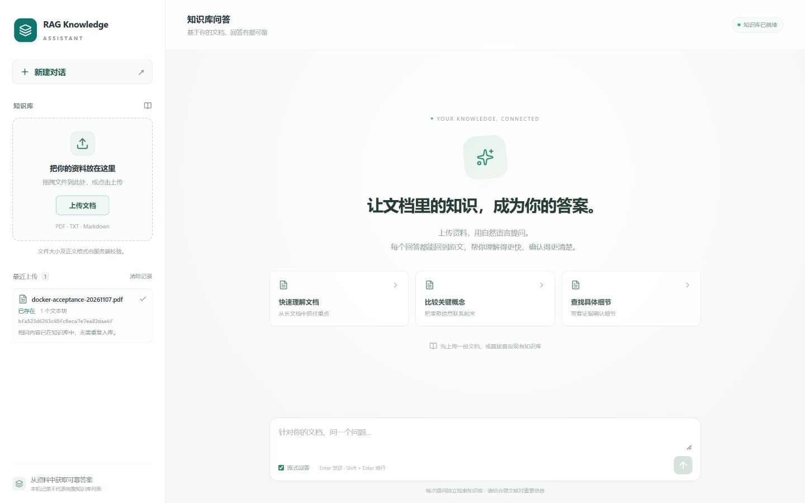
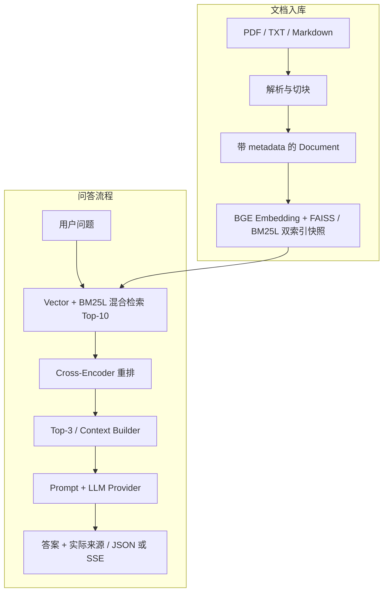

# RAG Knowledge Assistant

基于 **FastAPI + React** 的文档知识库问答应用。上传 PDF、TXT 或 Markdown 后自动解析、切块并建立索引，通过 **BGE 向量检索 + BM25L + Cross-Encoder 精排** 为大模型提供上下文，支持流式回答和可展开的原文来源。

不使用 LangChain 或 LlamaIndex。检索、重排、上下文构建、模型调用和评估模块独立实现，便于理解、替换和验证。



## 项目能力

- **上传与入库**：点击或拖拽上传，支持 UTF-8 TXT / Markdown 和文本型 PDF；校验扩展名、大小、PDF 签名及解析结果。
- **混合检索与精排**：归一化 BGE Embedding、FAISS `IndexFlatIP`、BM25L / jieba、Min-Max 加权融合，仅对召回候选执行 Cross-Encoder 重排。
- **流式回答与真实来源**：普通 JSON 或 POST SSE；返回实际进入 Prompt 的文件名、文档 ID、Chunk ID、页码、排名、分数和正文。
- **一致性与恢复**：双索引构建成功后整体替换；SHA256 去重、原子 Manifest 写入、失败保留旧索引，重启后恢复上传文档。
- **可靠性与评估**：空问题校验、空候选 `no_evidence`、空答案与断流处理、请求 ID、阶段耗时，以及检索指标和 QA 评审工作流。
- **完整 Web 与部署**：React 响应式界面、来源折叠展开、停止生成、非 root Docker / Nginx 部署。

## 系统架构



文档向量与查询向量均做 L2 归一化，因此内积等于余弦相似度。Hybrid 对两路候选分数分别做 Min-Max 归一化，再融合：

```text
final_score = 0.7 × normalized_vector_score + 0.3 × normalized_bm25_score
```

Cross-Encoder 只重排 Hybrid 的候选，不扫描整个知识库，也无法找回候选集之外的文档。分数用于排序，不代表答案正确率。

| 层级 | 技术 |
| --- | --- |
| 前端 | React、TypeScript、Vite、Lucide、Fetch / ReadableStream |
| API | Python 3.11、FastAPI、Uvicorn、Pydantic |
| 文档处理 | pypdf；字符、段落、递归切块 |
| 向量检索 | sentence-transformers、`BAAI/bge-small-zh-v1.5`、FAISS |
| 关键词与精排 | rank-bm25 / BM25L、jieba、`BAAI/bge-reranker-base` |
| 生成与部署 | OpenAI SDK 的 Responses 接口、DeepSeek、Docker Compose、Nginx |

## 快速启动：Docker

### 1. 准备环境与模型

需要 Docker Desktop（Linux containers / WSL2）或 Linux Docker Engine，以及 Docker Compose v2。后端使用 Linux/amd64、Python 3.11、CPU 推理；两个模型需要数 GB 可用内存，冷启动可能较慢。

```powershell
git clone https://github.com/dingdaoan-end/RAG-knowledge.git
cd RAG-knowledge
New-Item -ItemType Directory -Force data/uploads | Out-Null
if (-not (Test-Path .env)) { Copy-Item .env.example .env }
```

启动前自行准备完整的本地模型缓存。**构建和容器启动不会下载模型**，缺少模型时明确报错，不会自动替换为 Mock。`HF_CACHE_DIR` 指向 Hugging Face 的整个 **hub 目录**：

```text
hub/
├── models--BAAI--bge-small-zh-v1.5/
│   ├── blobs/
│   └── snapshots/<EMBEDDING_REVISION>/
└── models--BAAI--bge-reranker-base/
    ├── blobs/
    └── snapshots/<RERANKER_REVISION>/
```

缓存应包含权重、tokenizer 和配置；Embedding 还需 `modules.json` 及 `1_Pooling/config.json`。不要只复制或挂载失去链接目标的 snapshots 子目录。查看 Windows 本机已有版本：

```powershell
Get-ChildItem "$env:USERPROFILE/.cache/huggingface/hub/models--BAAI--bge-small-zh-v1.5/snapshots" -Directory -Name
Get-ChildItem "$env:USERPROFILE/.cache/huggingface/hub/models--BAAI--bge-reranker-base/snapshots" -Directory -Name
```

Linux 用户用 `mkdir -p data/uploads` 创建上传目录，并确保容器用户 **UID/GID 10001:10001** 可读写该目录；知识库及模型目录需允许该用户读取。

### 2. 配置 `.env`

只在本地编辑 `.env`，不要提交密钥。已有配置应保留；模板中的占位符需要替换。

| 变量 | 用途与示例 |
| --- | --- |
| `API_KEY` 或 `OPENAI_API_KEY` | 模型服务密钥，二选一；同时设置时优先读取非空 `API_KEY` |
| `MODEL_NAME` | 模型名称；当前项目验收配置为 `deepseek-flash` |
| `BASE_URL` | 当前服务地址；DeepSeek 为 `https://api.deepseek.com`，必须支持 Responses API |
| `HF_CACHE_DIR` | 宿主机 hub 绝对路径，如 `C:/Users/<用户名>/.cache/huggingface/hub` |
| `EMBEDDING_REVISION` / `RERANKER_REVISION` | 与本地 snapshot 目录名一致；默认值见 `.env.example` |
| `UPLOAD_DATA_DIR` | 上传与 Manifest 目录，默认 `./data/uploads` |
| `KNOWLEDGE_DIR` | 原始知识库目录，默认 `./data`，只加载其中的 `knowledge.txt` |
| `MAX_UPLOAD_BYTES` | 单文件上限，默认 `10485760`（10 MiB） |

**配置加载边界**：Compose 通过 `env_file` 注入变量，Python 使用 `Settings.from_env()` 读取。直接运行 Python 不会自动读取根目录 `.env`，需要先由终端或 IDE 注入环境变量。前端不接触密钥，Vite 也禁用了 dotenv 加载。

### 3. 启动与访问

```powershell
docker compose config --quiet
docker compose up -d --build
docker compose ps
```

首次构建需要网络拉取基础镜像和依赖包；运行时模型离线加载，真实问答仍需访问配置的 LLM 服务。

| 地址 | 用途 |
| --- | --- |
| http://127.0.0.1:8080/ | Web：上传、提问、查看来源 |
| http://127.0.0.1:8000/docs | FastAPI Swagger |
| http://127.0.0.1:8080/api/health | 后端存活检查 |
| http://127.0.0.1:8080/api/ready | 后端就绪检查 |

`/health` 的 200 只表示进程存活；模型和索引初始化完成后 `/ready` 返回 200，初始化中或失败返回 503。空知识库允许 ready。健康检查不调用 LLM，也不验证上游密钥、余额或网络。

浏览器使用同源 `/api/`，由 Nginx 转发到 `rag-api:8000`，不需要宽泛 CORS。前端容器 healthy 只表示静态服务正常，页面右上角另外显示后端就绪状态。

### 4. 持久化与日常操作

| 宿主机目录 | 容器路径 | 内容与权限 |
| --- | --- | --- |
| `UPLOAD_DATA_DIR` | `/app/data/uploads` | 读写：原文件、`manifest.json` |
| `KNOWLEDGE_DIR` | `/app/knowledge` | 只读：原始知识库 |
| `HF_CACHE_DIR` | `/models/hub` | 只读：模型缓存，不打进镜像 |

上传成功后立即可查，重复内容返回已有 document_id。重启或重建后校验 SHA256 并重建 FAISS / BM25 索引，无需持久化 FAISS 二进制。备份需同时保留上传原文件与 Manifest。

```powershell
docker compose logs -f rag-api
docker compose logs -f frontend
docker compose restart rag-api
docker compose up -d --force-recreate
docker compose down
```

停止时不要加 `-v`。保持单实例、单 worker，不要让多个进程共享同一上传目录。只更新前端时，执行 `docker compose build frontend` 后再执行 `docker compose up -d --no-deps frontend`。

## API 使用

下表为后端原始路径。通过前端入口调用时添加 `/api` 前缀，例如 `/api/chat`。

| 方法 | 路径 | 输入 / 返回 |
| --- | --- | --- |
| GET | `/health` | 进程状态 |
| GET | `/ready` | 初始化状态；200 或 503 |
| POST | `/documents/upload` | multipart 字段 `file`；新文件 201 / `indexed`，重复文件 200 / `duplicate` |
| POST | `/chat` | JSON `question`；返回 `answer`、`status`、`sources` |
| POST | `/chat/stream` | JSON `question`；返回 POST SSE |

上传示例（替换实际文件路径）：

```powershell
curl.exe --noproxy 127.0.0.1 -F "file=@D:/docs/notes.pdf" http://127.0.0.1:8080/api/documents/upload
```

支持 `.txt`、`.md`、`.markdown`、`.pdf`；文本必须为 UTF-8，接受 BOM。PDF 只提取已有文字，不支持 OCR；扫描、空白、加密或损坏 PDF 返回明确错误。

普通与流式问答示例，**执行会调用配置的真实 LLM 并产生用量**：

```powershell
$body = @{ question = "这份文档介绍了什么？" } | ConvertTo-Json
Invoke-RestMethod -Uri http://127.0.0.1:8080/api/chat -Method Post -ContentType "application/json; charset=utf-8" -Body ([System.Text.Encoding]::UTF8.GetBytes($body))

'{"question":"What does the document explain?"}' | curl.exe --noproxy 127.0.0.1 -N http://127.0.0.1:8080/api/chat/stream -H "Content-Type: application/json" --data-binary "@-"
```

普通响应结构示意，以下值不代表实际检索结果：

```json
{
  "answer": "回答正文",
  "status": "answered",
  "sources": [
    {
      "document_id": "<服务端返回的文档ID>",
      "source": "notes.pdf",
      "chunk_id": 0,
      "page": 1,
      "rank": 1,
      "score": 0.85,
      "content": "本次实际进入 Prompt 的原文"
    }
  ]
}
```

来源取自同一次检索、精排及最终 Top-K，不在生成后再次检索拼接；`source` 不暴露服务器绝对路径，`page` 仅在来源具备页码时出现。

SSE 事件顺序为 `sources → token... → done`：

| 事件 | data 字段 | 含义 |
| --- | --- | --- |
| `sources` | `{"sources":[...]}` | 实际上下文来源，先于答案发送 |
| `token` | `{"token":"文本增量"}` | 逐段追加文本 |
| `done` | `{}` 或 `{"status":"no_evidence"}` | 正常结束或确定性的空候选结果 |
| `error` | `{"message":"脱敏错误信息"}` | 中途失败，不再发送 done |

首段有效文本前生成失败返回 HTTP 502；开始发送后失败用 error 表示。只有 completed、没有有效文本，不会被标记为成功。前端使用 Fetch / ReadableStream 解析 POST SSE，支持分块 UTF-8、CRLF、多行 data、停止生成和断流提示。

空问题返回 422。最终候选为空时，HTTP 200、`status="no_evidence"`、`sources=[]`，不调用 LLM。**answered 只表示生成完成，不代表证据一定充分或答案已核验。** 响应头包含 `X-Request-ID`；上传超限为 413，不支持的格式为 415，正文或 PDF 无法解析为 422。

## 检索与 QA 评估

评估语料与在线知识库独立。V3 包含 **18 个合成技术 Chunk、50 道检索题、50 道 QA 题**；QA 中 42 道可回答、8 道证据不足。

四方案统一使用 Top-10 候选预算，QA 最终最多使用 Top-3 上下文。以下为已有 [V3 检索结果](results/v3_retrieval_comparison.json)，按 Query 宏平均，保留四位小数：

| 方案 | Recall@3 | Recall@10 | MRR@10 | nDCG@3 |
| --- | ---: | ---: | ---: | ---: |
| Vector | 0.8820 | 0.9610 | 0.9900 | 0.9613 |
| BM25L | 0.8287 | 0.9750 | 0.9400 | 0.9024 |
| Hybrid | 0.8853 | 0.9677 | 0.9800 | 0.9607 |
| Hybrid + Reranker | **0.9113** | 0.9677 | **1.0000** | **0.9762** |

本数据集上，精排改善前排排序和 Recall@3，但 Hybrid 的 Top-10 召回集合没有扩大，也不是每个 K 都更优。语料规模小、问题共享证据，不能据此推断生产泛化能力或最终回答准确率。

历史 QA 实验处理了 200 个单元，记录 197 个成功答案、3 个连接失败。后续两轮评审为 **AI 辅助评审，不是独立人工认证**。原始答案、实际上下文和失败信息均有保留，见 [综合实验报告](docs/v3_comprehensive_evaluation.md) 与 [AI 辅助评审说明](docs/v3_qa_ai_review.md)。平台计费对账与应用链路验证是不同事项，不用单次成功回答或小样本分数推断费用和总体质量。

复现检索评估（需准备模型，不调用生成 LLM）：

```powershell
.\.venv\Scripts\python.exe scripts/evaluate_retrieval.py --dataset data/evaluation/retrieval_eval_v3.json --output results/retrieval_local_new.json --candidate-k 10 --ks 3 5 10 --local-files-only
```

每次实验使用新的输出路径，已有报告默认拒绝覆盖。QA 的 `corpus_sha256` 绑定检索 JSON 原始字节的 SHA256，V1 / V2 / V3 必须正确配对，不要随意格式化冻结数据。

## 本地开发与测试

### 前端

需要 Node.js 22.12+。先启动已有 FastAPI / Docker 后端，再运行：

```powershell
cd frontend
npm ci
npm run dev
```

访问 http://127.0.0.1:5173/ 。Vite Proxy 默认转发至 `http://127.0.0.1:8000`；可在启动 Vite 的进程中用 `API_PROXY_TARGET` 指定后端。不要创建含密钥的 `VITE_*` 变量。

### Python

在项目根目录创建 Python 3.11 环境：

```powershell
py -3.11 -m venv .venv
.\.venv\Scripts\python.exe -m pip install -r requirements.txt
```

启动真实后端前，先通过终端或 IDE 注入模型服务环境变量，使用本地模型目录：

```powershell
.\.venv\Scripts\python.exe main.py --embedding-model "<本地BGE-Embedding目录>" --reranker cross-encoder --reranker-model "<本地BGE-Reranker目录>" --candidate-k 10 --top-k 3
```

占位符必须替换为完整模型目录；只用模型名称且本地无缓存时，第三方库可能尝试下载。直接运行 `main.py` 默认是 MockReranker，真实展示需显式启用 cross-encoder；Docker 正式入口已固定启用真实精排。

无需密钥的最小命令行示例：

```powershell
.\.venv\Scripts\python.exe main.py --mock --retrieval bm25 --query "什么是 RAG？"
```

此示例返回 MockLLM 固定答案，只验证链路。`--mock` 不会把需要的 Embedding 也换成假模型；CLI `--query` 只查询 `--file`，上传恢复用于 HTTP 服务。

### 测试

```powershell
# 项目根目录：默认跳过需显式启用的真实模型集成测试
.\.venv\Scripts\python.exe -m pytest -q

# frontend 目录
npm test
npm run build
```

最近一次完整回归记录（2026-11-08）：**后端 641 passed / 10 skipped，前端 37 passed，前端生产构建通过**。默认测试使用 fake / mock，不要求联网下载模型；10 项真实模型测试需显式设置 `RUN_MODEL_TESTS=1`，准备好缓存后再运行。

## 项目目录

```text
app/
├── api/               # 上传、问答、SSE、健康检查、请求追踪
├── ingestion/         # Document、Loader、Splitter、入库与恢复
├── embedding/         # BGE 批量编码与归一化
├── retrieval/         # FAISS、BM25L、Hybrid、Cross-Encoder
├── generation/        # Context Builder、Prompt、LLM Provider
├── evaluation/        # 检索指标、数据校验、QA 采集与评审
├── query/             # 改写预留接口，当前 Mock 仅清理首尾空白
└── pipeline.py        # 流程编排与答案 / 状态 / 来源
frontend/              # React、协议与组件测试、Nginx 镜像
data/evaluation/       # V1 / V2 / V3 冻结评测数据
data/knowledge.txt     # 默认在线知识库
data/uploads/          # 运行时上传与 Manifest，不提交 Git
scripts/               # 检索评估、QA 采集、综合实验入口
results/               # 历史实验、评审记录与机器可读结果
tests/                 # Python 单元与集成测试
docs/                  # 设计、实验与阶段验收记录
```

## 当前边界与常见问题

- **扫描 PDF**：暂不支持 OCR，无可提取正文时拒绝入库。
- **大规模语料**：仍使用精确 Flat 检索；每次上传重建完整双索引，适用于当前小型知识库。硬崩溃可能留下不入索引的孤立文件，尚无自动清理任务。
- **会话与文档管理**：多轮展示不等于服务端会话记忆；最近 20 条上传记录仅是浏览器元数据，清除记录不会删除知识库。暂未提供文档列表 / 删除 API。
- **证据充分性**：确定性 no_evidence 只处理空候选，非空上下文仍可能漏掉关键事实。当前按 Top-K 限制上下文，没有额外 token 预算截断器。
- **部署范围**：默认只绑定本机回环地址；尚无用户认证或公网 TLS，不建议直接暴露公网。
- **ready 未就绪**：检查模型目录、snapshot、文件权限、Manifest 和初始化日志。ready 正常也不代表 LLM 平台凭据或余额正常。
- **配置未生效**：直接运行 Python 不自动读取 `.env`；Compose 环境变量修改后需重新创建容器，例如 `docker compose up -d --force-recreate rag-api`，单纯 restart 不会重新注入。
- **日志与密钥**：用 `X-Request-ID` 关联检索、精排、生成和 HTTP 阶段；日志不记录完整 Prompt、回答或密钥。配置检查用 `docker compose config --quiet`，避免公开展开的环境变量。

## 延伸文档

| 主题 | 文档 |
| --- | --- |
| 检索与重排 | [Hybrid Search](docs/day6.md) · [Cross-Encoder](docs/reranker.md) |
| 数据与版本 | [V2 变更](docs/evaluation_dataset_v2_change_log.md) · [V3 数据审核](docs/evaluation_dataset_v3_review.md) |
| 评估工作流 | [检索评估](docs/day7_evaluation.md) · [QA 采集和评分](docs/day8_qa_evaluation.md) |
| 实验与分析 | [V3 综合评估](docs/v3_comprehensive_evaluation.md) · [AI 辅助评审](docs/v3_qa_ai_review.md) |
| 上传与持久化 | [入库实现与验收](docs/phase1_upload.md) |
| 部署与界面 | [Docker 实现记录](docs/phase2_docker.md) · [容器实际验收](docs/docker_runtime_acceptance_2026-11-07.md) · [前端验收](docs/frontend_implementation_2026-11-07.md) |

历史文档保留当时的阶段状态；当前启动方式与配置以本 README 和实际代码为准。
